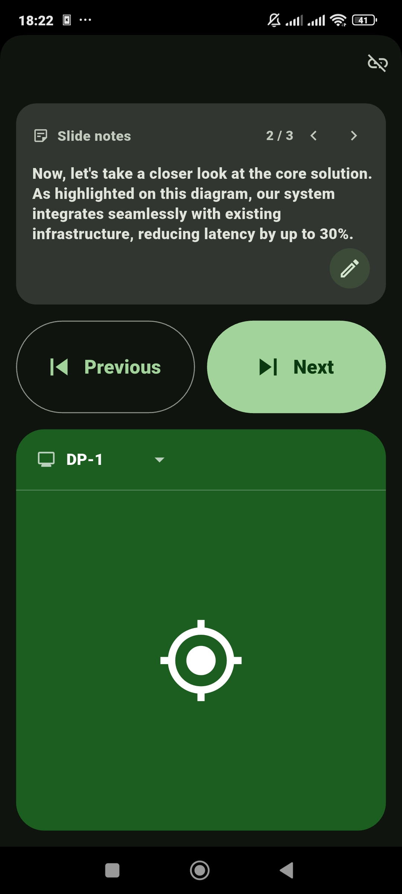

# HyprPresenter

A lightweight presentation remote for [Hyprland](https://hypr.land): control
slides and a laser pointer from your Android phone over the local network —
no cloud, no mouse takeover, no persistent desktop GUI.

Think of it as a physical presentation clicker that happens to live in your
pocket and draw a laser dot on your screen instead of on the wall.

## Preview



The phone app: per-slide presenter notes on top, Previous/Next in the
middle, and the hold-to-aim laser pad below, with the monitor selector
built into the pad's header.

## What you need

- A Linux machine running [Hyprland](https://hypr.land) (tested on
  0.57.1) — it hosts the laser overlay and receives the phone's commands.
- An Android phone on the **same local network** as the machine.
- To build from source: Rust 1.80+ for the desktop program, Flutter 3.x
  with the Android SDK for the app.

## Setup

### 1. Build and run the desktop overlay

```sh
git clone https://github.com/ShrlJamil/hyprpresenter
cd hyprpresenter
cargo build --release        # or plain `cargo build` for a debug build
./target/release/hypresent overlay
```

The overlay draws on every monitor, starts its WebSocket server on port
**8423**, and waits for a paired phone. Leave it running. (The binary is
called `hypresent`; the project, repository, and config paths keep the
`hyprpresenter` name.)

### 2. Pair the phone

In another terminal:

```sh
./target/release/hypresent pair
```

This prints a QR code in the terminal and stores the pairing token — only
its SHA-256 hash is kept, at `~/.config/hyprpresenter/pairing.sha256`
(mode 0600). **Re-running `pair` rotates the token**: previously paired
phones stop working immediately and must scan the new code.

### 3. Build and install the Android app

```sh
cd mobile
flutter build apk --release --split-per-abi
adb install -r build/app/outputs/flutter-apk/app-arm64-v8a-release.apk
```

Install the `arm64-v8a` build on any modern phone (about 24 MB); copying
the APK over and opening it on the phone works just as well. Release
builds are currently signed with the debug key — fine for installing on
your own phone, not a distribution build.

### 4. Connect

Open the app and tap **Scan QR**, then point the camera at the terminal
QR code from step 2. That is the whole pairing flow — nothing to type.
The app remembers the pairing and reconnects automatically on later
launches.

## Using it

- **Slides** — *Previous* / *Next* send PageUp/PageDown to the focused
  application on the desktop.
- **Laser** — press and hold the big pad: the dot appears at the centre
  of the active monitor and follows where you aim the **top edge of the
  phone** (lean it left/right, nod it up/down). Release hides the dot;
  every new hold re-anchors at the centre.
- **Multiple monitors** — the dropdown in the laser pad's header pins
  the laser to one output; the desktop enforces the confinement, so the
  dot cannot leak onto the other screen. *All screens* releases it.
- **Slide notes** — the notes button on the start screen (or the pencil
  button in the clicker's notes area) opens a notebook-style editor:
  one cell per slide, the wide **+** tile adds a slide, and everything
  auto-saves on the phone as you type. During the talk, the clicker's
  notes area shows the note for the current slide and follows
  Previous/Next; the small chevrons next to the counter re-sync the
  slide number by hand if you changed slides some other way.

Notes can also live in a plain Markdown file — written on the desktop,
opened from the editor or the clicker, and exported back out in the same
format:

```markdown
## 1
Opening: state the problem first, then the demo.

## 2
Point at the diagram; latency numbers are on this one.
```

One `## N` heading per slide (an empty note is fine — the number keeps
every later note in place). The parser is forgiving: `## Slide 1`
headings and `---` separators are accepted too.

## Status

Working today, and verified on real hardware (dual-monitor Hyprland
session, physical phone): the multi-output laser overlay, the
transport-agnostic command core, token pairing over WebSocket, the
clicker, the gyroscope laser (direction and sensitivity calibrated
on-device), monitor confinement, the slide-notes editor, and the app's
green UI with its own launcher icon.

Deliberately not there yet: auto-reconnect and wake lock in the app, a
desktop configuration file, packaging, and a systemd unit.

## Development

```sh
cargo build            # debug build
cargo run -- status    # health check against the live Hyprland session
cargo run -- probe     # list compositor Wayland protocols
cargo run -- overlay   # run the laser overlay
cargo fmt --check
cargo check
cargo test
cargo clippy --all-targets
```

The binary is a single crate — no workspace, no feature flags, no config file
yet. Dependencies are deliberately few (`serde`, `serde_json`, `thiserror`,
`wayland-client`, `wayland-protocols`, `wayland-protocols-misc`,
`wayland-backend`, and `smithay-client-toolkit` — the last pulls in `xkbcommon`
transitively) because each additional dependency in this project must earn its
place.

## Laser overlay

Run the overlay in one terminal:

```sh
cargo run -- overlay
# or restricted to one output:
cargo run -- overlay --output eDP-1 --radius 12
```

It creates one surface on the `overlay` layer per output, each covering its
full monitor, draws a red dot at the centre of the focused monitor, and
then waits.

From another terminal, control the running overlay:

```sh
cargo run -- overlay status          # outputs, dot, radius, color, keyboard state
cargo run -- overlay move 200 300    # global logical pixels (all outputs)
cargo run -- overlay center          # centre of the focused output
cargo run -- overlay hide            # draw empty (transparent) surfaces
cargo run -- overlay show            # draw the dot again
cargo run -- overlay radius 20       # 1-500 logical pixels
cargo run -- overlay color '#33ccff' # named color or #RRGGBB
cargo run -- overlay previous        # send PageUp to the focused application
cargo run -- overlay next            # send PageDown to the focused application
cargo run -- overlay quit            # clean shutdown: surfaces + socket removed
```

You can also set the initial appearance and position at launch:

```sh
cargo run -- overlay --x 200 --y 300 --radius 16 --color orange
```

Appearance commands apply immediately without restarting the overlay. Named
colors are `red`, `green`, `blue`, `yellow`, `cyan`, `magenta`, `white`, and
`orange`; hex input is exactly `#RRGGBB` (quote the `#` in a shell).

`hypresent overlay --help` lists all options.

### Coordinates and scaling

Control coordinates are **global logical pixels** across the whole layout,
not physical pixels and no longer output-local. The layout comes from
Hyprland IPC (`j/monitors`): positions there are already logical, and each
output's logical size is its physical mode size divided by its scale. On
the verification machine `eDP-1` is 1920×1200 physical at scale 1.25, so its
logical rect is 1536×960 at (-256, 120); `DP-1` is 1920×1080 at (1280, 0).
`move 512 600` therefore centres the dot on `eDP-1` (its local (768, 480),
physical ≈(960, 600)), and `move 2240 540` centres it on `DP-1`. A point
that lands in dead space between outputs belongs to no output: every
surface draws transparent and `status` reports `on=none`.

Each surface renders a buffer at the compositor's preferred fractional
scale (`wp_fractional_scale_v1`) and maps it onto the logical surface with
`wp_viewporter`. The observed buffers were 1920×1200 for the 1536×960
logical `eDP-1` surface (`scale=1.250`) and 1920×1080 for `DP-1`
(`scale=1.000`). If either fractional-scale protocol is unavailable, a
surface falls back to `wl_surface.set_buffer_scale()` with its output's
integer scale.

### Appearance model

The runtime appearance is one value — radius plus RGB color — shared by the
socket handler and the renderer, so the network command handler could
reuse it unchanged.

- Radius is in **logical pixels** and must be an integer from 1 to 500.
  Invalid values are rejected by both the CLI and the socket parser (exit
  code 7), and a command that does not change the radius does not redraw.
- Color is a strictly validated `Rgb` value. Named colors are matched
  case-insensitively; hex input must be `#RRGGBB`. Invalid colors are rejected
  without changing state.
- There is no separate opacity setting: the dot is fully opaque in the centre
  and only the anti-aliased edge is partially transparent. Buffer pixels are
  premultiplied ARGB, so the rest of the surface stays fully transparent and
  click-through.
- `status` reports `outputs=` (every surface), `dot=` (global position),
  `on=` (the output under the dot, or `none`), `radius=`, `color=#rrggbb`,
  `keyboard=ready|unavailable`, and per-output `buffers=` sizes/scales.

### Presentation keyboard input

`previous` and `next` inject `PageUp` and `PageDown` through
`zwp_virtual_keyboard_manager_v1` / `zwp_virtual_keyboard_v1`. This is a
separate native Wayland keyboard protocol; `zwlr_virtual_pointer_v1` is not
used because it cannot send key events.

- The input module uses its own Wayland connection, so a virtual-keyboard
  failure cannot tear down the laser overlay.
- The compositor's own XKB keymap is obtained from `wl_keyboard.keymap` and
  forwarded verbatim. No layout is generated or hardcoded, and no
  `XKB_DEFAULT_*` environment assumptions are made.
- Key events use raw Linux evdev codes (PageUp = 104, PageDown = 109), which is
  what the protocol expects; the compositor translates them through the
  forwarded keymap.
- Every command sends a complete press/release pair (20 ms hold). No modifiers
  are set, focus is never changed, and the real pointer is not moved.
- If the protocol is missing, the seat has no keyboard, or the keymap is
  rejected, the overlay keeps running. `status` shows `keyboard=unavailable`
  and `previous`/`next` return the exact error.
- The keymap is supplied by the compositor, so no privilege escalation,
  `/dev/uinput`, daemon, or system-wide input configuration is involved. The
  control socket is mode 0600 and limited to the current user.

### Input and layer behaviour

- Layer: `Overlay`, namespace `hyprpresenter-laser`.
- Keyboard interactivity: `None`; the overlay never takes keyboard focus.
- Input region: explicitly empty (`wl_surface.set_input_region` with an empty
  `wl_region`), so pointer buttons and motion pass through to the window below.
- Exclusive zone: `-1`, so the surface spans the full output (including space
  reserved by a top bar) instead of being shrunk to the usable area.
- Rendering: one ARGB8888 `wl_shm` buffer, reused for every frame; no GPU
  framework. Commands only update state and redraw once per event-loop batch,
  and a redraw waits for `wl_buffer.release` before reusing the slot, so rapid
  moves keep memory flat instead of growing the buffer pool.
- Cursor: never read, moved, hidden, or re-shaped by the overlay.

The test controls use `$XDG_RUNTIME_DIR/hyprpresenter-overlay.sock`. Set
`HYPRPRESENTER_SOCKET` to use a different path. This channel is intentionally
temporary and separate from the renderer so the network command handler
can replace it without touching the drawing code. A stale socket is removed on
the next launch; `quit` shuts down without leaving the process, surface, or
socket behind.

### Verified behaviour

Tested on the actual session (Hyprland 0.57.1, `eDP-1` 1920×1200 @ scale 1.25,
so a 1536×960 logical surface; compositor advertises
`zwp_virtual_keyboard_manager_v1 v1`):

- The dot rendered at physical (960, 600), the centre of the logical surface,
  with a ~29 px physical diameter for a 12 px logical radius.
- `move 200 300` rendered at physical ≈(250, 375); `hide` removed it; `show`
  and `center` restored it.
- `radius 24` while running produced a ~59 px physical diameter; `color green`
  rendered a green dot without a restart. `status` reported the new radius,
  color, dot position, and `keyboard=ready`.
- Invalid input was rejected by both the CLI and the socket: `radius 0`,
  `radius 501`, `radius abc`, `color #ff33`, `color #gggggg`, `color nope`.
  The CLI exits with code 7 and the socket returns an `error:` line; state is
  left unchanged.
- A real left-button event at the unchanged cursor position reached an
  underlying fullscreen `wev` window (press + release), confirming
  click-through and fullscreen visibility.
- The focused window did not change when the overlay started, during
  navigation, or after `quit`, confirming that it does not take keyboard focus.
- `previous`/`next` were received by a focused `wev` as `Prior` (evdev 112)
  and `Next` (evdev 117), each with a press/release pair; five of each produced
  exactly 5 press + 5 release events and no stuck keys.
- Application-level test: with `okular` focused, `next` changed the document
  from page 1 to 2 and `previous` returned it to page 1 (verified through
  Okular's D-Bus `currentPage`). Focus stayed on Okular throughout.
- A mixed burst of 400 moves, 100 radius changes, ~57 color changes, and 25
  hide/show cycles completed without protocol errors; RSS moved 13,544 →
  13,560 KB and VSZ (82,488 KB) and fd count (11) stayed fixed.
- The final burst state (dot 400,300; radius 18; `#33ccff`) rendered at
  physical ≈(500, 375) with centre pixel RGB (51, 204, 255).
- `quit` removed the layer surface and the socket and exited the process.

Keyboard tests use `wev` to prove protocol-level delivery and Okular to prove
one real application responds to PageUp/PageDown. This is not a claim that
every presentation application maps those keys the same way. Fullscreen
visibility was tested with a fullscreen toplevel, not with every possible
fullscreen client or direct-scanout/HDR path.

## Planned architecture

```
┌──────────────────────┐        Wi-Fi (LAN only)        ┌──────────────────────┐
│  Android app (future)│  ◄──── WebSocket + pairing ───► │  hyprpresenterd      │
│  Flutter             │      (server done, Phase 5)    │  (Rust daemon)       │
│  • prev/next buttons │                                 │  • networking layer  │
│  • laser hold button │                                 │  • pairing/auth      │
│  • orientation sens. │                                 │  • input adapter     │
└──────────────────────┘                                 │  • overlay renderer  │
                                                         └──────────────────────┘
```

The desktop side will be split into focused modules rather than a framework:

- `command` — implemented in `src/command.rs` (Phase 4): the
  transport-agnostic core. `Command`, `Appearance`, validation, the global
  layout geometry, and every state transition live here as pure, unit-tested
  code; transports (the UNIX socket and the WebSocket server) are thin
  adapters that execute the core's returned actions.
- `overlay` — implemented in `src/overlay.rs`: a transparent, click-through,
  always-on-top laser dot on the `overlay` wlr-layer-shell layer, one surface
  per output with an independent buffer lifecycle per surface. Built with
  `smithay-client-toolkit` + `wayland-client` (the same general approach as
  [hyprlaser](https://github.com/dcaixinha/hyprlaser), which is Apache-2.0
  and serves as a technical reference, not copied code — this repo is MIT and
  must stay license-clean).
- `input` — implemented in `src/input.rs`: presentation-control adapter on its
  own Wayland connection. Prev/next are injected as PageUp/PageDown through
  `zwp_virtual_keyboard_manager_v1` using the compositor's forwarded keymap, so
  applications that already handle those keys work without being special-cased.
  The evdev keycode mapping is a single `NavKeys` value (defaults 104/109,
  overridable with `--previous-key` / `--next-key`); the protocol code only
  consumes it. `zwlr_virtual_pointer_v1` is pointer-only and is not used for
  key events.
- `net` — implemented in `src/net.rs` (Phase 5): the LAN WebSocket server
  and the pairing-token provisioning (`hypresent pair`). Synchronous
  `tungstenite` on a dedicated thread — no async runtime; sessions forward
  `ControlRequest`s into the same event-loop channel as the socket handler.
- `main` — CLI entry point and lifecycle glue.

### Design notes / constraints carried forward

- **The laser dot must be independent of the real mouse cursor.** The phone
  drives an in-overlay coordinate, not `zwlr_virtual_pointer` motion, so the
  user's actual mouse is untouched. Presentation prev/next use
  `zwp_virtual_keyboard_manager_v1` (PageUp/PageDown), not the virtual pointer.
  Hyprland supports both protocols (verified on 0.57.1).
- **Click-through is mandatory.** Layer-shell overlay layer + empty input
  region. Known Hyprland quirk (hyprwm/Hyprland#14136-style discussions):
  exclusive keyboard interactivity on an overlay layer can capture pointer
  events even with an empty input region; the overlay uses
  `keyboard_interactivity: none` to avoid that path entirely, and input
  pass-through has been verified on the real session.
- **Fractional scaling** on Hyprland needs `wp_fractional_scale_v1` +
  `wp_viewporter`; Hyprland advertises both (confirmed on this machine), and
  the overlay uses them when present.
- **Layer-shell sizing**: with all four edges anchored, `set_size(0, 0)` lets
  the compositor report the full logical output size. `exclusive_zone(-1)` is
  required for the surface to keep the full output height instead of being
  shrunk by an existing top panel's exclusive zone.
- **Multiple monitors** (Phase 4, done): one overlay surface per `wl_output`,
  positioned through Hyprland IPC (`j/monitors`) global layout coordinates.
  `--output NAME` remains as a single-output restriction for debugging.

### Phase 4 (implemented)

**Reusable command core + multi-monitor overlay** — done, as specified in
the three steps this section used to recommend:

1. `src/command.rs` holds `Command`, `Appearance`, validation, layout
   geometry, and the `LaserState` transitions. The socket handler in
   `overlay.rs` only parses, forwards, and executes the core's actions
   (navigate / quit) — verified by unit tests that run without a compositor
   (16 tests total, all passing; clippy and `cargo fmt --check` clean).
2. One layer surface per `wl_output`, each with its own shm pool/buffer;
   the global layout comes from `j/monitors` (`scale` is now parsed, and
   logical size = physical / scale).
3. `NavKeys` in `src/input.rs` is the single navigation-key mapping,
   overridable via `--previous-key` / `--next-key`. With a custom mapping,
   the `previous`/`next` replies report the injected evdev keycode instead
   of the PageUp/PageDown names.

Verified on the real session (Hyprland 0.57.1, `eDP-1` 1536×960 logical at
(-256, 120) scale 1.25 + `DP-1` 1920×1080 at (1280, 0), DP-1 focused):

- `status` at startup: `outputs=eDP-1,DP-1 … configured=2/2`, buffers
  `eDP-1:1920x1200@1.250,DP-1:1920x1080@1.000`; the initial dot sat at the
  focused output's centre (2240, 540 on DP-1) per the `center` rule.
- Pixel-exact placement from `grim` captures: after `move 512 600` the
  eDP-1 centre pixel was exactly RGB (255, 0, 0) with 716 red pixels around
  it (theory: π·(12·1.25)² ≈ 707); after `move 2240 540` the DP-1 centre was
  exactly (255, 0, 0) with 453 red pixels (π·12² ≈ 452), and the eDP-1
  centre was back to the bare wallpaper — the dot fully leaves a surface
  when it moves to another output.
- After `color '#33ccff'` + `radius 18`, the DP-1 centre pixel was exactly
  RGB (51, 204, 255) with 973 matching pixels (π·18² ≈ 1017 before
  anti-aliasing).
- `move 0 0` (dead space above eDP-1) reported `on=none` and drew nowhere.
- A burst of 200 cross-monitor moves left RSS essentially flat
  (21,688 → 21,704 KB) with 12 fds; no window was focused before or after
  the run and the overlay took no focus; `quit` removed both surfaces and
  the socket and exited the process.
- `--output DP-1` ran single-output (`configured=1/1`); an unknown
  `--output NOPE` failed with the available-output list; invalid `radius 0`
  and `color '#ff33'` through the CLI still exit with code 7.

### Phone protocol (WebSocket, v1)

The overlay listens on `ws://0.0.0.0:8423` (configurable with
`overlay --ws-port N`; `--no-ws` disables it). One client at a time.

The command is **`hypresent`** (the binary was renamed from
`hyprpresenter` for typing comfort; the package, repository, config paths
and the pairing URI scheme keep the full name). Pairing, on the desktop:

```sh
hypresent pair    # generate a fresh token + QR; re-running ROTATES it
```

Asking to pair again *is* the revocation: the new token's hash replaces
the old one, so the previous token stops working immediately. (The old
`pair --regenerate` spelling is still accepted as an alias.)

When a token is generated, `pair` also renders a **terminal QR code**
encoding `hyprpresenter://pair?host=<lan-ip>&port=8423&token=<token>` —
the phone app's Scan QR screen pairs in one gesture, so the token never
has to be typed (it is still printed as text underneath as a fallback).

Only the token's SHA-256 hash is stored
(`~/.config/hyprpresenter/pairing.sha256`, mode 0600), so the stored file
cannot be replayed as a token. The hash file is re-read for every
connection, so pairing and revocation take effect without restarting the
overlay. There is no TLS in this phase by design: the trust model is
"pairing token + local network".

Every message is one JSON object. The client **must** authenticate before
any command is accepted:

```json
{"v": 1, "type": "auth", "token": "<pairing token>"}
```

A command sent before authentication is refused with an error reply but
does not close the connection — the client may still authenticate on it
(30 s window; at most 5 failed token attempts per connection).

Commands (same names and validation as the core; coordinates are global
logical):

```json
{"v": 1, "cmd": "move", "x": 2240, "y": 540}
{"v": 1, "cmd": "center"}   {"v": 1, "cmd": "show"}    {"v": 1, "cmd": "hide"}
{"v": 1, "cmd": "radius", "value": 20}
{"v": 1, "cmd": "color", "color": "#33ccff"}
{"v": 1, "cmd": "previous"} {"v": 1, "cmd": "next"}
{"v": 1, "cmd": "status"}   {"v": 1, "cmd": "quit"}
{"v": 1, "cmd": "confine", "output": "DP-1"}   {"v": 1, "cmd": "confine", "output": null}
```

The `confine` command (Phase 6.2) pins the laser to one output: moves
clamp into that output (inset by the dot radius) and `center` targets it;
`output: null` releases it. The `status` reply carries `confined=` and an
`areas=` field (`NAME:X,Y,W,H` per output, `;`-separated) so clients can
draw a monitor picker and steer in the right rectangle.

Every reply is one JSON object: the core's reply text in an envelope, with
`ok` mirroring whether the core treated it as an error.

```json
{"v": 1, "ok": true,  "reply": "ok dot=2240,540"}
{"v": 1, "ok": false, "error": "invalid pairing token"}
```

A development client that speaks this protocol lives in
`examples/ws_client.rs` (`cargo run --example ws_client -- ws://HOST:8423
TOKEN '{"cmd":"next"}'`).

### Phase 5 (implemented)

**Networking** — done, as specified in the plan this section used to hold:

1. `src/net.rs`: synchronous `tungstenite` WebSocket server on its own
   thread, one client at a time. Sessions decode JSON into `Command` with
   the core's own validators and forward `ControlRequest`s through the
   same calloop channel as the UNIX-socket handler — the event loop cannot
   tell the transports apart. No async runtime was added (the only new
   dependencies are `tungstenite` and `sha2`).
2. Pairing as designed above: random 192-bit token, SHA-256 hash storage,
   per-connection re-read, and re-running `pair` revokes. A server that cannot
   bind its port logs the error and the overlay continues socket-only.
3. The server lives inside the overlay process (not a separate daemon);
   the split remains a later option, not a prerequisite.

One implementation lesson worth keeping: `tungstenite`'s `write()` only
queues a frame — without an explicit `flush()` the peer receives nothing,
which cost a debugging round here (both the server replies and, in the
first live test, the test client's own sends were stuck in the queue). All
sends go through one helper that writes and flushes.

Verified on the real session (same dual-monitor setup as Phase 4), using
`examples/ws_client` as the phone stand-in:

- No-auth command → `{"ok":false,"error":"not authenticated: send an auth
  message first"}` and the session ends; wrong token →
  `"invalid pairing token"`; correct token → `"authenticated"`.
- `move`/`radius`/`color` via WS changed the state exactly as the socket
  does (a parallel socket `status` showed the identical line), and a
  `grim` capture put the dot's target pixel at exactly RGB (51, 204, 255)
  after a WS `color #33ccff` + `move`. `next`/`previous` replied with the
  PageDown/PageUp key names.
- A burst of 100 WS moves: every reply `ok`, RSS 22,788 → 22,800 KB.
- Disconnect + reconnect with fresh auth works; `quit` via WS replied
  `ok shutting down`, the overlay exited and the socket was removed.
- 20 unit tests pass (4 new for the protocol/pairing, including the
  published SHA-256("abc") vector); clippy clean; `cargo fmt --check` clean.

Verified from a second physical device on 2026-11-11: the phone
(192.168.1.2) connected over Wi-Fi with a generic WebSocket tester app,
authenticated, survived well past the app's 2000 ms ping interval, and
drove `move` + `color #33ccff`; the laptop's status showed
`dot=512,600 on=eDP-1 color=#33ccff` and a `grim` capture confirmed the
dot's pixel at exactly RGB (51, 204, 255). Two robustness fixes came out
of that phone test and are now part of the design: **pong replies go
through the same flush helper as every other send** (an unflushed pong
let the phone's ping watchdog kill an authenticated session after ±4 s),
and **the auth phase tolerates racing commands** — a command sent before
auth gets an error reply but the connection stays open (30 s window, up
to 5 failed token attempts), because real clients reconnect and race
their first command. A third lesson came from the first app run: a
client that vanishes without closing (app killed, Wi-Fi dropped) leaves
a half-open session that would hold the single session slot forever and
starve the real client's handshake in the TCP backlog — so any session
with **no traffic at all for 120 s (pings count as traffic) is
evicted**.

### Phase 6 — Android app

The app lives in `mobile/` in this same repository (one repo on purpose:
the protocol is a shared contract and both sides still change together;
`mobile/` can be split out with its history if it ever needs its own
life). Flutter, package `com.sahruljamil.hyprpresenter_mobile`, speaking
protocol v1 over `dart:io` WebSocket — no networking dependency.

- **Pairing (6.1)** is **QR-only**: the start screen is one Scan QR
  button (plus reconnect for a stored pairing); the desktop's `pair` QR
  carries host, port, and token. The values persist and later launches
  reconnect automatically. There is deliberately no manual form.
- **Gyroscope laser (6.2):** one dominant hold pad fills the clicker.
  Press-and-hold shows the laser at the centre of the active area and
  anchors the phone's orientation; while held, the dot follows the
  **deflection of the phone's top edge** from that anchor — the barrel
  you actually aim with. (The first build decomposed the rotation
  vector instead; that threw away roll, which is how a hand steers
  sideways, and horizontal movement felt walled-in around the centre.
  The deflection model steers naturally in every direction and was
  confirmed on-device.) A complementary filter (gyro integration
  corrected by the accelerometer's gravity direction, integrated with
  the sensors' own timestamps) feeds it in `lib/gyro_pointer.dart`.
  Moves stream at ~50/s and are **fire-and-forget** on the WebSocket —
  no reply is awaited, because a synchronous round trip per move made
  the server process a stale queue one point at a time (visible
  stepping); the event loop renders only the newest position.
  Sensitivity is one constant (0.67 rad sweeps the full area), tuned in
  the hand. On multi-monitor setups the pad's header carries a monitor
  dropdown and the **desktop enforces the clamp** via the `confine`
  command; the default is the output the dot is on. There is no
  Show/Hide button: the hold pad *is* the laser switch, and releasing
  it hides the dot.
- **Slide notes:** a notebook-style editor (one cell per slide, a wide
  **+** tile to add, autosave on every keystroke) reachable from the
  start screen and from the clicker's notes area. Notes persist on the
  phone as a Markdown file in the app's documents directory — the same
  `## N` format the app opens and exports through the system file
  dialogs, so notes prepared on the desktop and notes typed on the
  phone are interchangeable. The clicker counts slides from its own
  Previous/Next presses and shows the matching note; chevrons next to
  the counter correct the number manually.
- **Presentation:** all-English UI on a green Material You theme, a
  custom launcher icon (adaptive + legacy), rotation locked to
  portrait. The app is built per-ABI with obfuscation; the arm64
  release is 23.4 MiB.

Verification: 23 Rust tests and 15 Flutter tests pass (command core,
gyro model, gravity convergence, status parsing, notes format
round-trip), `flutter analyze` and clippy are clean, and the whole
flow — QR pairing, clicker, gyro laser, confinement — is exercised on
the author's real phone against the real dual-monitor session. Still
open (Phase 6.3): auto-reconnect and a wake lock for long sessions.

## License

MIT — see [LICENSE](LICENSE). The upstream `hyprlaser` project is
Apache-2.0 and is used only as *architecture-level* inspiration; no source is
copied. If that ever changes (e.g. vendoring actual code), the license will
be revisited before the code lands.
